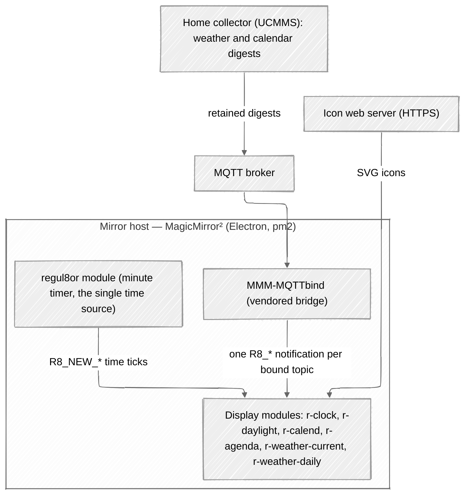
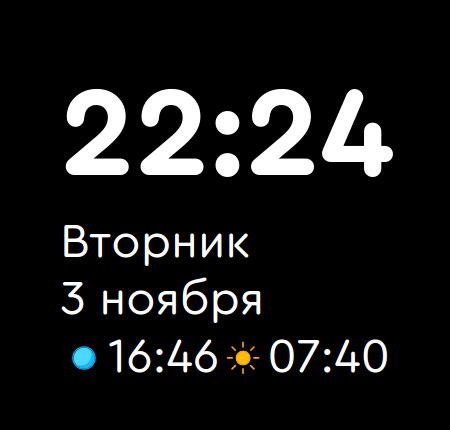
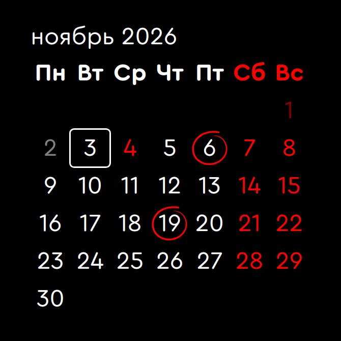
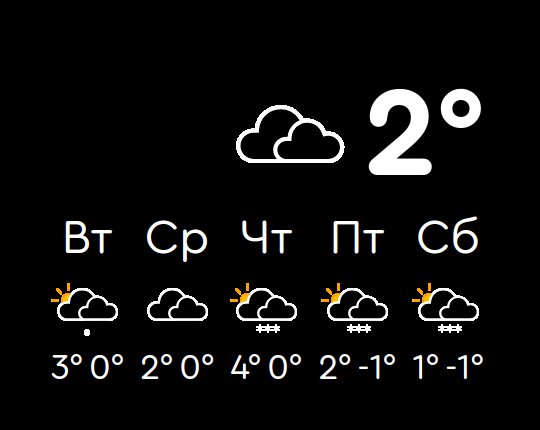

# Mirror

**Document Last Updated**: 2026-11-04\
**Project Status**: Production

A MagicMirror² installation that turns a hallway mirror into a personal assistant: time, daylight, a marked calendar, an agenda of upcoming items, and current and daily weather.

All data arrives over MQTT as retained digests published by a sibling home-automation project (UCMMS). The mirror is a passive subscriber — it renders the latest state and publishes nothing.

## How It Works



## Requirements

- An SBC with a display (the target is an Orange Pi) running stock MagicMirror²
- Node.js and pm2
- An MQTT broker with the home weather and calendar digests on retained topics
- An HTTPS icon host (weather icons and the Lucide set), trusted through the home CA

## Quick Start

1. Push the changes to git master.
2. Deploy the manifest `deploy.yaml` (Muster). It copies the config, the launcher scripts and the module directories to the mirror host.
3. On the mirror host: `pm2 restart mm`.

The full deployment procedure and the host layout: `docs/MIRROR_ARCHITECTURE.md`, section 6.

## Usage

- Smoke tests (plain Node, no jsdom): `node test/<module>.test.js`
- Display power: `mirror-display.sh on|off` (runs as root; the systemd timers run it daily)
- Verify what the mirror host actually runs: its HTTP server serves the deployed module files at `/modules/<name>/<file>`

## Configuration

Everything lives in `mirror/config.js`:

- **Module entries** — every setting (icon set, caps, the kind-to-icon map, the bound notification). The custom modules carry behavior only, no defaults.
- **`r8` map** — the home notification names. The modules and the MQTT bindings reference the map, never a string.
- **`iconSets` map** — a set name to its full URL.
- **`formats` map** — the shared Intl format options.
- **MMM-MQTTbind bindings** — one exact topic per notification. No wildcards.

## Repository Structure

```
├── deploy.yaml                      ← Muster deployment manifest
├── bin/
│   ├── import-nss-root.sh           ← post-deploy hook: trusts the home CA in the mirror user's NSS database
│   └── mirror-display.sh            ← display DPMS on/off (root)
├── docs/                            ← project documentation
├── mirror/                          ← files deployed to the mirror host
│   ├── config.js                    ← MM² configuration (settings, the r8 map, the bindings)
│   ├── custom.css                   ← global styles
│   ├── mm.sh, mm_start.sh           ← launcher scripts
│   ├── MMM-MQTTbind/                ← vendored MQTT bridge; LOCAL_CHANGES.md lists the local patches
│   ├── regul8or/                    ← time source module; shared fonts and CSS variables
│   ├── r-clock/                     ← clock widget
│   ├── r-daylight/                  ← daylight widget
│   ├── r-calend/                    ← calendar grid with day marks
│   ├── r-agenda/                    ← agenda list
│   ├── r-weather-current/           ← current weather widget
│   └── r-weather-daily/             ← daily forecast widget
├── systemd/                         ← display power schedule (units and timers)
└── test/                            ← plain-Node smoke tests and the DOM stub
```

## Screenshots

### Clock and Daylight



### Calendar



### Weather



## Attribution

This project was built using AI-assisted development.\
regul8or set the requirements and direction; AI agents did the implementation work.\
Commits with AI contributions are marked appropriately.
